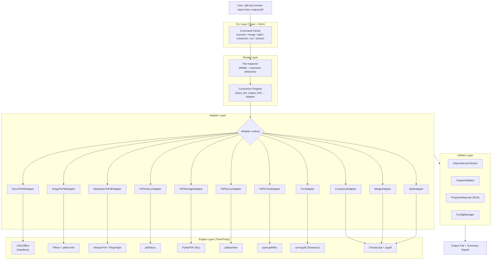
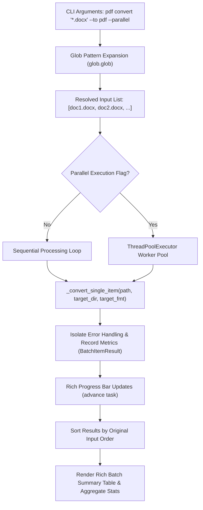

# 🏗️ Architecture — `pdf-tool` CLI

> [!NOTE]
> This document describes the full system architecture of `pdf-tool`, a universal document conversion CLI. It is a living document and should be updated whenever a structural decision changes.

---

## Table of Contents

1. [System Overview](#1-system-overview)
2. [High-Level Architecture Diagram](#2-high-level-architecture-diagram)
3. [Project Structure](#3-project-structure)
4. [Core Layers](#4-core-layers)
   - [CLI Layer](#41-cli-layer)
   - [Router Layer](#42-router-layer)
   - [Adapter Layer](#43-adapter-layer)
   - [Engine Layer](#44-engine-layer)
   - [Utilities Layer](#45-utilities-layer)
5. [Conversion Matrix](#5-conversion-matrix)
6. [Dependency Management Strategy](#6-dependency-management-strategy)
7. [Error Handling Strategy](#7-error-handling-strategy)
8. [Data Flow](#8-data-flow)
9. [Configuration](#9-configuration)
10. [Distribution](#10-distribution)
11. [Batch Processing & Concurrency Model](#11-batch-processing--concurrency-model)

---

## 1. System Overview

`pdf-tool` is a **modular, adapter-based CLI** for document conversion and PDF manipulation. It does not implement any conversion algorithm from scratch. Instead, it acts as an intelligent **orchestration layer** that:

- Detects input/output intent from file extensions or explicit flags.
- Routes to the **correct specialized adapter** for that specific conversion type.
- Validates dependencies at startup and provides actionable install instructions.
- Wraps all operations in a consistent, friendly terminal UX (progress bars, structured error messages, summaries).

> [!IMPORTANT]
> The core philosophy: **no single library handles all conversions with high fidelity**. The architecture deliberately delegates each conversion to the best-in-class engine for that job. The CLI is the glue, not the workhorse.

---

## 2. High-Level Architecture Diagram



---

## 3. Project Structure

```
pdf-converter/
│
├── docs/                        # Project documentation
│   ├── architecture.md          # ← This file
│   ├── decisions.md             # ADR log
│   └── planner.md               # Phase tracker & progress
│
├── pdf_tool/                    # Main package
│   ├── __init__.py
│   ├── main.py                  # Typer app entry point
│   │
│   ├── cli/                     # CLI command definitions
│   │   ├── __init__.py
│   │   ├── convert.py           # `pdf-tool convert` command
│   │   ├── merge.py             # `pdf-tool merge` command
│   │   ├── split.py             # `pdf-tool split` command
│   │   ├── compress.py          # `pdf-tool compress` command
│   │   ├── ocr.py               # `pdf-tool ocr` command
│   │   └── doctor.py            # `pdf-tool doctor` command
│   │
│   ├── router/                  # Routing logic
│   │   ├── __init__.py
│   │   ├── file_inspector.py    # MIME + extension detection
│   │   └── registry.py          # Adapter registry + lookup
│   │
│   ├── adapters/                # One adapter per conversion type
│   │   ├── __init__.py
│   │   ├── base.py              # Abstract BaseAdapter
│   │   ├── docx_to_pdf.py
│   │   ├── image_to_pdf.py
│   │   ├── markdown_to_pdf.py
│   │   ├── html_to_pdf.py
│   │   ├── pdf_to_docx.py
│   │   ├── pdf_to_image.py
│   │   ├── pdf_to_csv.py
│   │   ├── pdf_to_text.py
│   │   ├── ocr.py
│   │   ├── compress.py
│   │   ├── merge.py
│   │   └── split.py
│   │
│   └── utils/                   # Shared utilities
│       ├── __init__.py
│       ├── dependency_checker.py # Checks system binaries
│       ├── output_validator.py   # Verifies output file integrity
│       ├── progress.py           # Rich progress bar wrappers
│       └── config.py             # Config file (~/.pdf-tool/config.toml)
│
├── tests/                       # Test suite
│   ├── fixtures/                # Sample files (docx, pdf, png, etc.)
│   ├── unit/
│   └── integration/
│
├── pyproject.toml               # Project metadata + dependencies (UV)
├── Dockerfile                   # Multi-arch Docker image
└── README.md
```

---

## 4. Core Layers

### 4.1 CLI Layer

**Technology:** `Typer` + `Rich`

The CLI layer is the **only user-facing surface**. Each sub-command lives in its own file under `pdf_tool/cli/`. Responsibilities:

- Parse and validate user arguments (file paths, flags, output options).
- Resolve output path defaults (e.g., same directory as input with new extension).
- Instantiate the router and pass clean inputs.
- Render Rich progress spinners, status tables, and final summary.

```
pdf-tool convert  <INPUT> [OUTPUT] [--to FORMAT] [--quality HIGH|MEDIUM|LOW]
pdf-tool merge    <FILE1> <FILE2> ... -o <OUTPUT>
pdf-tool split    <INPUT> [--pages 1-3,5] [--every N] -o <OUTPUT_DIR>
pdf-tool compress <INPUT> [--level high|medium|low] -o <OUTPUT>
pdf-tool ocr      <INPUT> -o <OUTPUT> [--lang eng]
pdf-tool doctor
```

### 4.2 Router Layer

**Files:** `router/file_inspector.py`, `router/registry.py`

The router is the **brain** of the dispatch system.

- **`FileInspector`:** Uses `python-magic` (libmagic bindings) for true MIME detection — not just extension parsing. Falls back to extension if MIME is ambiguous.
- **`ConversionRegistry`:** A dictionary mapping `(input_mime, output_format)` tuples to the correct `Adapter` class. Adapters register themselves via a decorator at import time.

```python
# Example registration (inside each adapter module)
@registry.register(input_fmt=["docx", "doc"], output_fmt="pdf")
class DocxToPdfAdapter(BaseAdapter): ...
```

### 4.3 Adapter Layer

**Base class:** `adapters/base.py`

Every adapter must implement the `BaseAdapter` interface:

```python
class BaseAdapter(ABC):
    @property
    @abstractmethod
    def required_deps(self) -> list[str]:
        """Return list of system binary names this adapter needs."""

    @abstractmethod
    def convert(self, input_path: Path, output_path: Path, **options) -> ConversionResult:
        """Execute the conversion. Return a result with metadata."""
```

Before `convert()` is called, the router always calls `DependencyChecker.verify(adapter.required_deps)` and raises a clean `MissingDependencyError` with install instructions if something is absent.

### 4.4 Engine Layer

The external tools that do the actual heavy lifting. These are **never called directly by user code** — only through adapters.

| Engine | Type | Invocation |
| :--- | :--- | :--- |
| LibreOffice | System binary | `subprocess` with `--headless` |
| Ghostscript | System binary | `subprocess` |
| ocrmypdf / Tesseract | System binary | `subprocess` + Python API |
| PyMuPDF (`fitz`) | Python library | Direct import |
| Pillow + pillow-heif | Python library | Direct import |
| pdf2docx | Python library | Direct import |
| pdfplumber | Python library | Direct import |
| pymupdf4llm | Python library | Direct import |
| WeasyPrint | Python library | Direct import |
| Playwright | Python library | Direct import (optional) |

### 4.5 Utilities Layer

| Utility | Responsibility |
| :--- | :--- |
| `DependencyChecker` | Resolves system binary paths via `shutil.which()`. Reports missing deps in a formatted Rich table. |
| `OutputValidator` | Opens the output file post-conversion to verify it's non-empty, valid, and readable. |
| `ProgressReporter` | Thin wrapper around `rich.progress.Progress` for consistent spinner/bar UX. |
| `ConfigManager` | Reads/writes `~/.pdf-tool/config.toml` for persistent user preferences (e.g., default DPI, compression level). |

---

## 5. Conversion Matrix

| Input Format | Output Format | Adapter | Primary Engine |
| :--- | :--- | :--- | :--- |
| DOCX, DOC | PDF | `DocxToPdfAdapter` | LibreOffice |
| XLSX, XLS | PDF | `DocxToPdfAdapter` | LibreOffice |
| PPTX, PPT | PDF | `DocxToPdfAdapter` | LibreOffice |
| ODT, ODS, ODP | PDF | `DocxToPdfAdapter` | LibreOffice |
| RTF | PDF | `DocxToPdfAdapter` | LibreOffice |
| JPG, PNG, WEBP | PDF | `ImageToPdfAdapter` | Pillow |
| HEIC, HEIF | PDF | `ImageToPdfAdapter` | Pillow + pillow-heif |
| TIFF | PDF | `ImageToPdfAdapter` | Pillow |
| Markdown (.md) | PDF | `MarkdownToPdfAdapter` | WeasyPrint / Playwright |
| HTML | PDF | `HtmlToPdfAdapter` | WeasyPrint / Playwright |
| PDF | DOCX | `PdfToDocxAdapter` | pdf2docx |
| PDF | JPG, PNG | `PdfToImageAdapter` | PyMuPDF |
| PDF | CSV, XLSX | `PdfToCsvAdapter` | pdfplumber |
| PDF | TXT, MD | `PdfToTextAdapter` | pymupdf4llm |
| PDF (scanned) | PDF (searchable) | `OcrAdapter` | ocrmypdf |
| PDF | PDF (compressed) | `CompressAdapter` | Ghostscript |
| Multiple PDFs | PDF (merged) | `MergeAdapter` | pypdf |
| PDF | Multiple PDFs | `SplitAdapter` | pypdf |

---

## 6. Dependency Management Strategy

> [!WARNING]
> System-level dependencies (LibreOffice, Tesseract, Ghostscript) are the primary source of friction for new users. This must be handled gracefully.

**Three-tier strategy:**

1. **`pdf-tool doctor`** — Scans `$PATH` for all required binaries and prints a per-adapter diagnostic table with exact install commands for macOS (Homebrew), Debian/Ubuntu (APT), and Windows (Winget/Choco).

2. **Lazy Dependency Checks** — Each adapter declares its own `required_deps`. The router only checks dependencies for the adapter it actually needs, not all adapters at startup.

3. **Fallback Chains** — Where possible, adapters define a fallback engine:
   - Markdown → PDF: WeasyPrint first, Playwright fallback, error only if both missing.
   - PDF Compress: Ghostscript first, pypdf fallback (less aggressive but zero system deps).

---

## 7. Error Handling Strategy

All errors are caught at the adapter boundary and re-raised as typed exceptions from `pdf_tool.exceptions`:

```
PdfToolError (base)
├── MissingDependencyError   → dep not found in PATH
├── UnsupportedConversionError → no adapter for (input, output) combo
├── ConversionFailedError    → engine returned non-zero / crashed
├── InvalidInputError        → input file is corrupt, empty, or wrong format
└── OutputValidationError    → output file failed post-conversion check
```

The CLI layer catches `PdfToolError` and renders a user-friendly Rich panel with the error type, message, and suggested fix — never a raw Python traceback for known failure modes.

---

## 8. Data Flow

```
Input File(s)
     │
     ▼
FileInspector.detect(path) ──────────────────────────────────────────────┐
     │                                                                    │
     ▼                                                                    │
ConversionRegistry.lookup(input_fmt, output_fmt) ──> UnsupportedConversionError
     │
     ▼
DependencyChecker.verify(adapter.required_deps) ──> MissingDependencyError
     │
     ▼
OutputPathResolver.resolve(input_path, output_arg) ──> resolved output path
     │
     ▼
ProgressReporter.start()
     │
     ▼
adapter.convert(input_path, output_path, **options)
     │                │
     │      ConversionFailedError (on non-zero exit / exception)
     │
     ▼
OutputValidator.validate(output_path) ──> OutputValidationError
     │
     ▼
ProgressReporter.finish()
     │
     ▼
Rich Summary Panel: [✓ output_path | size delta | time taken]
```

---

## 9. Configuration

User preferences are stored in `~/.pdf-tool/config.toml`:

```toml
[defaults]
output_dir = ""          # Empty = same dir as input
compression_level = "medium"
image_dpi = 150
ocr_language = "eng"
markdown_renderer = "weasyprint"  # or "playwright"

[engines]
libreoffice_path = ""    # Override auto-detected path
ghostscript_path = ""
tesseract_path = ""
```

Config is read by `ConfigManager` at startup and values are passed as defaults to CLI option parameters.

---

## 10. Distribution

| Channel | Details |
| :--- | :--- |
| **PyPI (via UV/pip)** | `pip install pdf-tool` — installs Python dependencies only. User must install system binaries. `pdf-tool doctor` guides them. |
| **pipx** | `pipx install pdf-tool` — isolated environment, same as above. Recommended for end users. |
| **Docker** | `docker pull ghcr.io/user/pdf-tool:latest` — all system deps pre-installed. Ideal for CI/CD or server use. |
| **Homebrew (macOS)** | Future: a brew formula that installs both pdf-tool and all system deps automatically. |


---

## 11. Batch Processing & Concurrency Model



### Key Principles

1. **Failure Isolation:** Each file conversion runs in an isolated `try...except` boundary. An unreadable, corrupt, or missing dependency on one file does not interrupt the processing of remaining files.
2. **Resource Scheduling:** By default, `--parallel` (`-j`) uses `min(32, file_count)` worker threads. Since the primary bottlenecks are I/O bound (disk operations) or release the GIL in native C libraries / external subprocesses (LibreOffice, Ghostscript, Tesseract), Python's `ThreadPoolExecutor` delivers optimal throughput without inter-process IPC overhead.
3. **Structured Reporting:** At completion, the batch summary table displays every file's status, individual duration, output file size, and error explanations, with aggregate timings and exit code 1 if any conversions failed.
