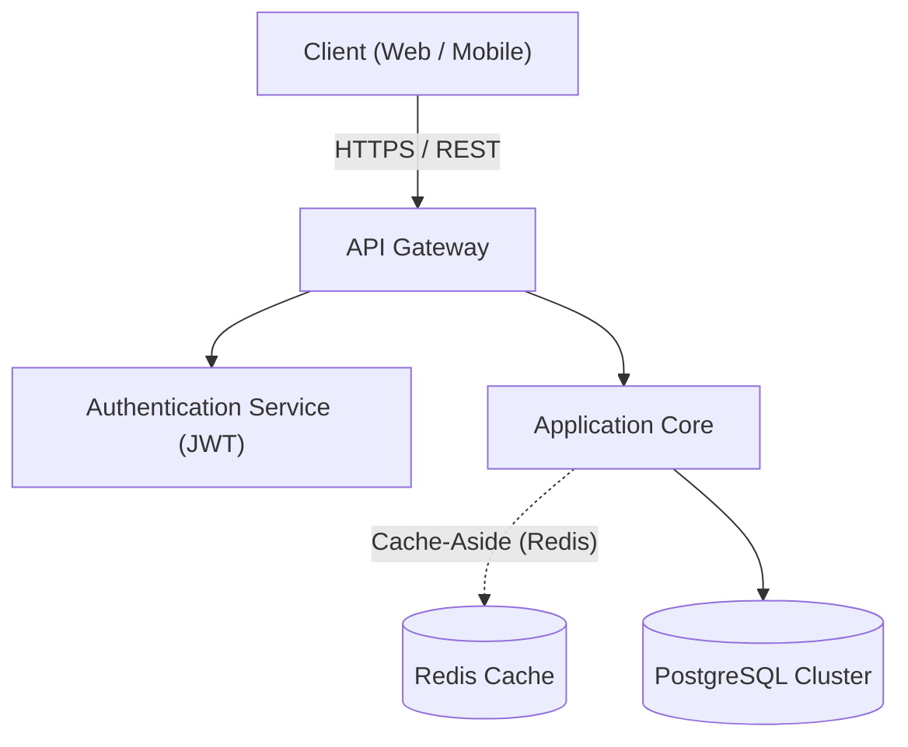
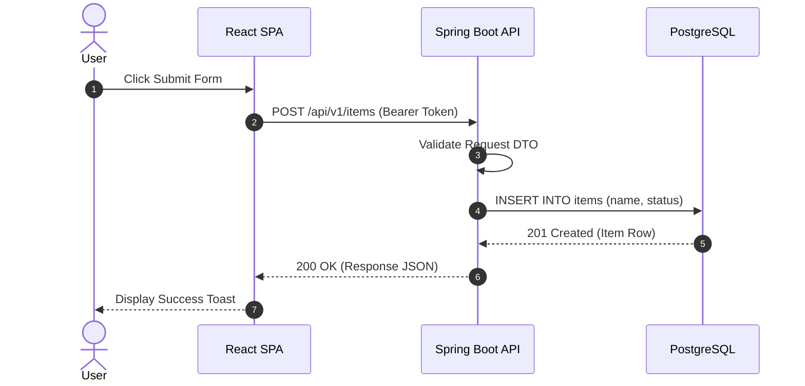
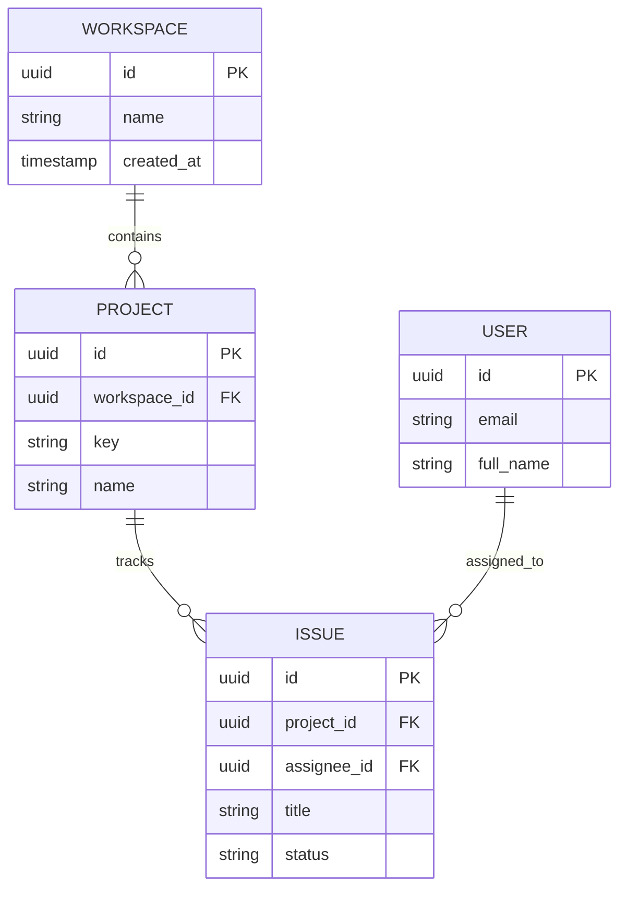

# System Architecture & Flowchart Sample

This sample document showcases **Markdown to PDF** compilation with embedded **Mermaid.js vector diagrams**, code syntax highlighting, and responsive typography.

---

## 1. High-Level Flowchart



---

## 2. Request Lifecycle Sequence



---

## 3. Entity Data Model



---

## 4. Configuration & Settings Table

| Setting Key | Default Value | Description |
| :--- | :--- | :--- |
| `app.security.token-ttl` | `3600s` | Expiration time for generated JWT bearer tokens |
| `app.cache.max-entries` | `10000` | Maximum cache capacity in Redis |
| `app.concurrency.workers` | `8` | Thread pool size for parallel batch operations |

---

## 5. Sample Application Code

```python
def process_event(event_id: str, payload: dict) -> bool:
    """Validate and dispatch domain event to transactional outbox."""
    if not event_id or not payload:
        return False
    logger.info("Processing event %s with %d entries", event_id, len(payload))
    return True
```
